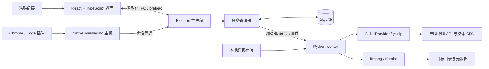
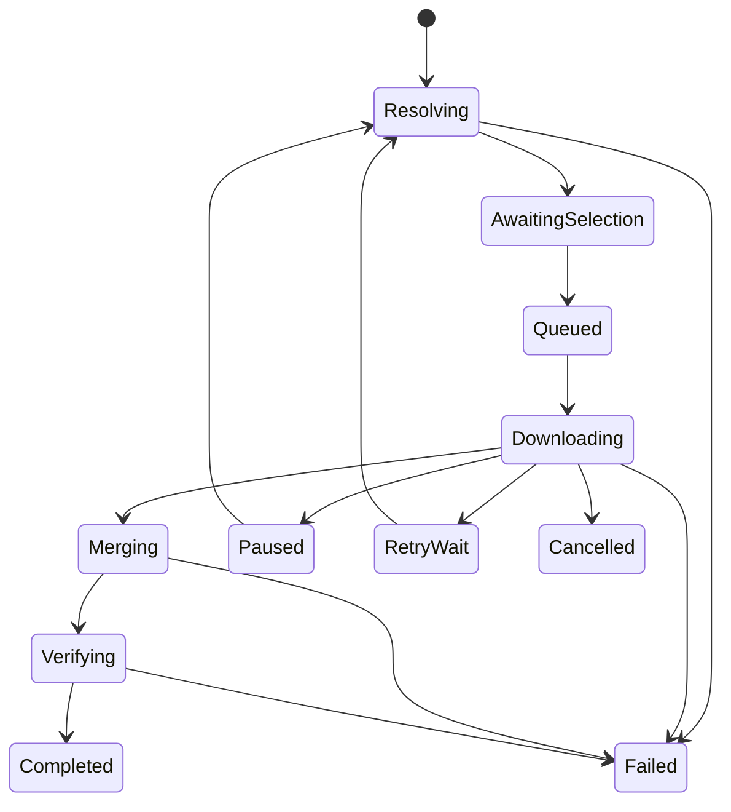

# 哔哩哔哩高清视频下载工具：设计分析

日期：2026-11-01。本文为设计方案；网络资料核对不等于本机下载验证。

Windows MVP 已开始落地，本文描述的完整架构包含后续阶段。当前实现、真实样本与已知差异见 [MVP 验证记录](mvp-verification.md)；例如 SQLite、托盘与恢复功能尚未纳入 MVP。

v0.2.0 按新增需求加入独立的可选[水印后处理](watermark-processing.md)。下载仍采用无重编码合并；水印处理另外生成重新编码副本，不改变下载原文件。

## 1. 设计结论

建议采用 **Windows 桌面客户端 + 可选 Chrome／Edge 扩展 + 本地下载引擎**。

按用户选定的方向，客户端采用 **Electron + React + TypeScript + Python**：React 渲染界面，Electron 主进程组织桌面能力与任务，Python 执行解析和下载。

先完成客户端独立使用的闭环：粘贴链接 → 解析分 P 与可用格式 → 选择视频／音轨 → 下载 → 无重编码合并 → 校验 → 打开文件。插件随后提供 B 站页面内的一键入口，所有任务交给本地客户端管理。

主要原因：高清下载需要处理账号权限、音视频分离、大文件、临时链接、进程中断及文件落盘。客户端更适合承担这些工作；插件适合获取当前视频和减少复制链接的步骤。

默认假设是 Windows 单人本地使用，不设云端账号服务。Electron 可以为未来其他桌面系统复用界面，但首版只验证 Windows；Python、ffmpeg、凭据存储和安装包仍需按系统分别适配。

## 2. “高清原版”能做到什么

必须区分三个概念：

1. **上传源文件**：UP 主提交平台的文件。普通播放链路不应被视为源文件下载接口，本产品不承诺取得它。
2. **平台高画质播放流**：平台处理后，当前视频、账号、地区及接口实际允许访问的版本。这是本工具的目标。
3. **无二次压缩保存**：保存所选播放流，通过重新封装合并音视频，不主动重新编码；这不能恢复平台此前压缩丢失的信息。

yt-dlp 的 B 站解析实现包含独立视频流、音频流、编码、帧率和动态范围信息，也会提示缺少需会员权限的格式。因此，界面必须根据实际解析结果显示能力，不能只根据视频页面上的画质名称作承诺。[B 站解析器源码](https://raw.githubusercontent.com/yt-dlp/yt-dlp/master/yt_dlp/extractor/bilibili.py)

界面建议使用“最高可用画质”“保留平台编码”“无重编码合并”。4K／高帧率／HDR／高码率等能否下载，以当前账号实际返回的可访问格式为准，不写死“登录必有 1080P”“会员必有 4K”。

首版面向用户自有或获授权保存的普通投稿视频；遇到不可访问、DRM、会员权限不足或地区限制时说明原因，不设计绕过这些限制的功能。

## 3. 现有目录与复用判断

目标目录 `D:\Vido\bilibili-download-vido` 在本次设计开始时为空。

相邻项目 `D:\Vido\vido-download-tool` 已有：

- .NET 8 WPF 桌面界面及 MVVM 结构。
- Python／yt-dlp 引擎，stdin／stdout JSON Lines 进程桥。
- ffmpeg 定位、下载进度、取消、配置与日志等基础设施。

已检查其 README、`python/engine.py`、`Services/PythonEngineClient.cs` 和项目配置。可参考 Python 引擎、协议设计、工具定位与错误处理；WPF／C# 界面及客户端进程桥不直接复用，使用 React 和 Electron 主进程重新实现。

需要重新设计的部分：

- 现有协议主要以 `height` 选择清晰度，不能唯一表达同分辨率的不同帧率、编码、HDR 和音轨。
- 现有引擎以单个忙状态组织任务，不直接等同于持久化队列和崩溃恢复。
- B 站需要独立的登录态、分 P、格式与错误映射。
- 不继承 YouTube 特有的运行时探测、客户端回退及字幕策略。

新客户端以用户选择的 Electron 技术栈为准，不再采用此前建议的 WPF 方案，也不需要用户安装 .NET。现有项目的复用重点转为 Python 侧与经过审查的业务逻辑。

## 4. 五种实现形式比较

### A. 纯网页：打开网站直接下载

优势是无须安装、易分发，适合展示产品、说明使用方式和轻量解析结果。

困难在于：普通网站不能直接读取 bilibili.com 的登录 Cookie，跨域请求受服务端 CORS 策略约束；在浏览器中处理多 GB 音视频的合并，还要面对内存、临时存储、文件写入权限及页面关闭后的任务恢复。浏览器端 WASM 合并在部分环境可行，但不能据此承诺长视频稳定下载。

结论：不作为首版下载核心。如果网页调用本机下载助手，它实际上已经是“网页 + 本地服务”方案。

### B. 云端网页：服务器解析并代下载

服务器更容易执行下载与合并，但会引入流量、磁盘、清理、部署及运维成本，也会把用户登录态和私人视频访问集中到服务器。

若将来必须提供这一形态，需要独立评估凭据管理、任务隔离和资源配额。当前单人本地使用没有这些收益，不建议建设。

### C. 独立浏览器插件：在 B 站页面内完成下载

优点是入口自然，可以利用浏览器中用户已登录的会话。最小版本可处理直接下载或分别保存音视频，但完整的单文件输出还需要合并流程。

Chrome Manifest V3 的扩展 service worker 可能被终止，不能依赖常驻全局变量维持任务。浏览器下载管理器能接管部分下载，这与自行在 service worker 中跑完整下载、合并流程是两回事。[Chrome 生命周期文档](https://developer.chrome.com/docs/extensions/develop/concepts/service-workers/lifecycle)

若坚持完全免客户端，需要额外设计扩展页／offscreen 工作环境、磁盘缓存与 WASM 合并，并实测大文件上限。技术上不是完全不可做，但首版投入和兼容性风险较高。

结论：适合作为轻量入口；不优先作为长视频下载和合并的唯一载体。

### D. 独立桌面客户端

可以管理本地文件、运行 ffmpeg、维护队列、保存中断状态并在浏览器关闭后继续执行。缺点是需要下载安装和维护发布包。

本项目选用 Electron + React + TypeScript 构建客户端，便于实现视频格式选择、任务列表和实时进度等界面。代价是随包携带 Chromium／Node.js 带来的安装体积与基础内存开销，以及 Node 与 Python 两侧的依赖维护。对以网络下载和媒体合并为主的工具，这种取舍可以接受，实际资源占用仍需测量。

结论：首版最佳选择。客户端必须能在未安装浏览器扩展时独立完成下载。

### E. 插件 + 本地客户端／助手

插件识别当前 BV、当前分 P，点击后将任务交给客户端。客户端负责会话验证、格式解析、排队、下载与合并。关闭视频页不影响已接管任务。

通信优先使用 **Native Messaging → 小型本地主机 → Windows 命名管道 → 客户端任务管理器**。Native Messaging 是浏览器与注册的本机应用通信的正式机制，需要安装器注册主机并限制允许连接的扩展 ID。[Chrome Native Messaging](https://developer.chrome.com/docs/extensions/develop/concepts/native-messaging)

本地主机只传控制消息，不通过它传输媒体文件。主机不是持久任务所有者：浏览器退出后，客户端进程继续管理任务。安装器分别验证 Chrome／Edge 的注册方式与扩展 ID。

结论：长期推荐形态，但在独立客户端稳定后增加，避免首版同时调试安装、浏览器权限和下载链路。

## 5. 引擎与框架选择

建议组合：

- **界面：React + TypeScript**，开发构建采用 Vite，管理表单、分 P、格式选择和任务视图。
- **桌面外壳与任务管理：Electron + TypeScript**，主进程处理窗口、托盘、目录选择、任务调度与持久化；preload 提供有限的类型化接口。
- **解析／下载：独立 Python worker + yt-dlp**，封装成 `BilibiliProvider`，避免界面依赖第三方内部结构。
- **媒体处理：ffmpeg／ffprobe**，用于音视频重新封装和结果检查。
- **持久化：SQLite** 保存任务、选择、状态与历史；凭据单独存储。
- **扩展：Manifest V3**，只做页面识别、当前分 P 和发送入口；可选提供用户主动授权的登录态传递。
- **发布：Windows x64 完整便携目录或安装包**，包含运行时与经过验证的引擎、ffmpeg 版本，普通用户不需要手工配置 Python。

Electron 区分 main、renderer 与 preload；主进程具备系统能力，React 运行在 renderer 中，通过受控的 preload 接口访问功能。下载工作交给 Python 子进程，主进程只异步调度，不运行耗时媒体工作。[Electron 进程模型](https://www.electronjs.org/docs/latest/tutorial/process-model)

yt-dlp 提供格式选择、Cookie 导入、结构化元数据与进度接口；实现时使用 Python API 和自定义 JSONL 事件，避免解析人类可读的终端日志。[yt-dlp 使用及嵌入文档](https://github.com/yt-dlp/yt-dlp#embedding-yt-dlp)

BBDown 曾是 B 站专用候选，但原仓库页面显示已于 2026-05-14 归档，目前不作为默认核心依赖。若以后考虑维护中的分支，需要重新核验维护状态、许可证及实测能力。[BBDown 原仓库](https://github.com/nilaoda/BBDown)

完全自研播放 API 解析器会承担签名、鉴权和接口变化的持续维护成本，首版不采用。仅定义可替换 provider 边界，不提前实现多引擎自动回退。

## 6. 系统架构与职责

- Electron 主进程是任务状态的唯一写入者；React 订阅状态快照与事件，Python worker 报告事实，均不直接修改队列表。
- 首版下载并发为 1，解析操作也应限流；后续实测后再开放更高并发。
- 每个执行中的下载使用可独立终止的 worker；主进程通过 Node `child_process.spawn` 启动，使用参数数组并保持 `shell: false`，不拼接 shell 命令。Windows 发布版需验证进程树清理：仅向父进程调用 kill 不视为足够，必要时使用小型 Job Object helper 管理 Python／ffmpeg 子树。
- stdout 只输出 UTF-8 JSONL；stderr 为诊断通道，输出前脱敏。
- 第一版不开放 HTTP 端口。若未来实现 localhost 网页控制台，另行设计随机配对令牌、Origin 校验及环回绑定。
- 主窗口关闭默认最小化到托盘，并清楚说明任务继续；选择“退出”时保存状态并停止子进程。电脑休眠或应用退出期间不承诺继续下载。

### Electron 进程边界

- renderer 仅加载随包提供的本地界面，设置 `nodeIntegration: false`、`contextIsolation: true`、`sandbox: true`，并配置 CSP；不向 React 暴露任意文件读写、命令执行或通用 `ipcRenderer`。
- preload 只暴露具体能力，例如解析链接、创建任务、暂停任务、选择目录和订阅进度；参数及返回值使用共享 TypeScript 类型，主进程另做运行时校验，不能依赖编译期类型保证输入可信。
- 主进程校验 IPC 来源、参数、任务归属和允许打开的 URL；限制窗口导航及新窗口创建。官方页面使用受限的外部浏览器打开流程，不在具备应用权限的窗口中加载远程网页。
- Cookie 由主进程和 Python 执行端按需使用，React 只接收账号状态，不接收 Cookie 值。
- 主进程对 JSONL 使用流式缓冲拆行与最大消息大小限制，不能假设每次 stdout 数据事件刚好是一条 JSON。进度更新合并后推送界面，初始目标每任务每秒最多 4 次，终态立即推送。
- SQLite 的 Node 适配层避免长时间阻塞主进程；若采用原生模块，必须按 Electron ABI 打包与验证。具体驱动在脚手架阶段选定并锁版本。

这些边界遵循 Electron 的上下文隔离、沙箱和 IPC 校验建议。[Electron 安全说明](https://www.electronjs.org/docs/latest/tutorial/security)

## 7. 登录与账号权限

首版可先支持未登录解析，再增加用户主动导入的 B 站会话。建议顺序：

1. **用户指定的 Cookie 文件**：导入时仅保留 B 站所需域与字段，验证账号状态，随后在应用私有存储中保存。
2. **可选插件传递**：用户明确点击“连接本地客户端／授权 B 站登录态”后，通过扩展后台读取所需域的 Cookie，再交给允许的本地主机。页面脚本不接触凭据。
3. **浏览器配置读取作为辅助方案**：必须由用户选择浏览器与配置；Windows 的加密和文件锁可能使读取失败，不承诺自动成功，不提权破解读取。
4. **二维码登录作为后续增强**：需要单独验证完整登录、过期、确认与退出流程，不能仅展示一个二维码就宣称可用。

会话验证结果显示“未登录／会话有效／会话过期／无法验证”，会员状态仅在可靠获取时显示。账号有效不等于任意视频均可下载。

凭据由 Electron 主进程通过 `safeStorage` 加密，Windows 下使用 DPAPI 保护，加密结果放在应用用户数据目录，数据库只存 `authProfileId`。检查加密能力可用后再允许持久保存，不能静默改存明文。[Electron safeStorage](https://www.electronjs.org/docs/latest/api/safe-storage)

引擎确需明文文件时，在当前用户可读的私有临时目录创建，完成后清理，启动时清理崩溃残留。承认执行期间仍有明文暴露窗口，尽量缩短生命周期。

退出登录清除应用保存的会话；用户原始导入文件由用户自行管理。日志、历史导出、错误上报和结果元数据均不得包含 Cookie、签名媒体 URL 或认证请求头。

## 8. 解析、分 P 与格式选择

支持普通视频完整链接、BV 号、带 `p=` 的链接，以及 b23.tv 短链接。短链接解析必须限制跳转次数、验证每次目标，不接受任意 URL 代理下载。最终只允许已支持的 B 站视频入口。

解析返回视频标题、作者、BV、分 P 的 CID／序号／标题／时长，以及当前分 P 的实际格式。默认只选当前 P，不因链接可展开就自动下载全部分 P；用户可明确多选。

每个格式展示：

- 视频：平台画质标签、宽高、帧率、编码、动态范围、码率、大小或估算大小。
- 音频：编码、码率、声道、采样率及可获得的音轨标签；未知字段不编造。
- 状态：实际可选／明确不可用；若平台仅声明某档位但未给可访问媒体流，不把它当可下载格式。

不能仅以 `height` 保存选择。使用 `bvid + cid + videoFormatId + audioFormatId` 及规格快照；format ID 跨解析可能变化，重新解析后需核对规格。

提供两种策略：

- **最高可用画质**：在实际返回格式中按分辨率、用户的帧率／动态范围偏好选择。相同档位内再比较同编码的码率；AV1、HEVC、AVC 不能简单以码率判定谁画质更好。显示最终选中的编码和规格，允许手动改选。
- **兼容优先**：优先可用的 H.264 + AAC 与 MP4；若因此低于最高分辨率或帧率，在开始前明确显示差异。

HDR 与 SDR 属于不同观看偏好，不自动宣称 HDR 对所有设备更好。最高画质的选择若涉及这种取舍，显示明确候选供用户确认。没有某一编码时不能通过重新编码“制造平台原版”。

下载前重新解析以获取新媒体地址，并核对选定格式。如果权限或格式改变，进入“等待选择”，禁止静默降低清晰度。

## 9. 无重编码合并与文件组织

ffmpeg 的 streamcopy 路径不执行解码与重新编码，适合作为默认合并方式。但输出容器必须支持所选流，HDR／杜比等元数据保留仍需逐类验证。[FFmpeg 官方文档源文件：Streamcopy](https://raw.githubusercontent.com/FFmpeg/FFmpeg/master/doc/ffmpeg.texi)

设计原则：

- 默认保留原编码，使用 `-c copy`，按实际媒体轨道明确映射。
- 优先在兼容时输出 MP4；若所选轨道或元数据无法按预期封装，提供经过验证的 MKV 或“保留分离原流”选项，不静默转码。
- HDR／杜比等高级格式未通过验证前标为实验能力；不能只看到标签就承诺无损保留所有元数据。
- 字幕不烧录进视频，弹幕不烧录。后续可选保存外置字幕、封面、弹幕原始文件。
- ffprobe 检查轨道、分辨率、帧率、时长与可识别的动态范围字段。完成标志要求文件存在、媒体校验通过及原子改名成功。
- “无重编码”不是成品文件与上游文件逐字节相同；封装结构和容器元数据会改变。

建议路径：`作者/视频标题_BV号/P01_分P标题_画质标签_编码.mp4`。标题需要清理 Windows 非法字符、保留名及路径长度；多次下载通过任务键与文件检查去重，不直接覆盖。

每个任务使用独立临时目录；合并临时输出位于目标文件同一卷，验证成功后原子改名。失败保留可恢复媒体，不把半成品当成成功文件。

可选的结果 `.json` 保存 BV、CID、原页面链接、所选轨道规格、引擎版本、完成时间与本地 SHA-256。它用于可追溯和之后的本地完整性核对；没有平台校验值时，不能据此证明上游原始文件一致性。

## 10. 队列与恢复

该图表达主路径；各非终态均应有取消、错误与应用退出处理。

- 任务记录保存用户选择、阶段、相对临时路径、已完成轨道、错误及重试时间；不依赖永久保存签名下载 URL。
- 暂停先结束下载进程并保存半成品；恢复是重新解析后尝试续传，不等于挂起线程。
- 媒体地址失效后重新解析同一 CID。仅在规格及资源一致性可以确认、服务端支持续传时复用片段；不能确认时重下受影响轨道，避免拼接不同资源。
- 403 可能有多种原因，只允许有限次地址刷新；401／会话过期提示重新授权；429 进入退避，遇到验证挑战等待用户在官方页面处理。
- 网络重试采用有限次数的指数退避与抖动；磁盘不足、无权限和格式不匹配不无限重试。
- 默认最多 3 次自动重试是产品初始值，需用真实样本调优，不是平台保证。
- 合并阶段不承诺暂停／续合并；中断后保留已下载轨道并重新合并。
- 应用崩溃后将执行中任务标为“已中断”，检查临时文件，再由用户恢复；不把旧的进度百分比当作事实。

大小未知时显示已下载字节和速度，不伪造精确百分比或剩余时间。视频下载、音频下载、合并和校验分别展示阶段，避免“100% 后仍长时间无反馈”。

## 11. 数据与进程协议

建议实体：

- `VideoInfo`：BV、标题、作者、分 P 列表。
- `FormatOption`：实际格式 ID、媒体类型、规格、可用状态；短期地址只用于执行。
- `DownloadTask`：任务 ID、CID、格式选择、策略、输出位置、状态、进度、错误、重试次数、创建／更新时间。
- `AuthProfile`：凭据引用、验证时间与状态；不保存明文到 SQLite。
- `TaskArtifact`：轨道临时文件、成品路径、校验信息与清理状态。

客户端至 worker 的命令包括 `probe`、`download`、`cancel`、`shutdown`；暂停由任务管理器组织取消与保留。事件包括 `metadata`、`formats`、`progress`、`stage`、`auth_required`、`error`、`completed`。

协议统一包含 `protocolVersion`、`requestId`、`taskId`；事件另带单调序号，确保迟到事件不会覆盖新执行实例的状态。命令只接受固定字段，不允许界面或插件传入任意 ffmpeg／shell 参数。

扩展重复点击用请求幂等键去重；客户端判断是否已有相同 CID 和轨道选择。安装器注册的本地主机严格限制扩展 ID，管道限制当前 Windows 用户，插件后台验证页面消息来源与载荷。

## 12. 界面与交互设计

主窗口以“添加任务 → 确认格式 → 查看队列”为主线，不堆叠工具参数。

顶部：链接输入、解析按钮、账号状态。中间：封面与标题、分 P 勾选、视频与音轨选项、输出目录。底部：待下载／进行中／已完成任务，展示真实阶段、速度、已完成字节、暂停／恢复／取消／打开目录。

默认下载按钮旁直接呈现本次选择，例如“1080P · 60fps · HEVC · AAC · 无重编码”。示例仅描述显示方式，不意味着当前视频一定有此格式。

错误提示给出可执行动作：会话过期→重新授权；格式消失→重新选择；磁盘不足→切换目录；访问受限→打开官方页面检查；网络中断→等待退避或重试。

插件首版只需弹出面板：当前视频、当前 P、客户端连接状态、“发送到客户端”。客户端负责详细格式选择。若未安装客户端，展示安装指引，不显示虚假的“已开始下载”。

## 13. 发布、更新与维护

建议使用 electron-builder 生成 Windows NSIS 安装包，另提供完整便携目录。Electron 的应用代码放入应用包，Python 引擎、ffmpeg、ffprobe 作为独立资源置于 ASAR 外，通过 `process.resourcesPath` 定位，不能依赖开发时工作目录。资源随包分发可使用 `extraResources` 配置。[electron-builder 文件配置](https://www.electron.build/contents/)

Python worker 优先使用 PyInstaller `onedir` 打包，保留 stdio JSONL 通信，不使用禁用标准输入输出的 windowed 模式；由 Electron 通过 `windowsHide: true` 隐藏控制台。需要验证 yt-dlp 动态模块、证书及其依赖是否被完整收集。`onedir` 便于定位缺失依赖，发布后用户无需安装 Python；Windows 包需要在对应平台构建。[PyInstaller 打包原理](https://pyinstaller.org/en/stable/operating-mode.html)

应用设置、SQLite、凭据和日志写入 `app.getPath('userData')` 或明确的用户目录，不能写入安装资源目录。安装在含空格、中文的路径以及只读安装目录均需验收。

客户端版本和解析引擎版本分开记录。发布时锁定一组经过验证的依赖，避免安装后随机拉取最新版破坏行为。

引擎升级应在任务空闲时执行，使用可信来源与完整性检查，保留上一个可用版本；首版可先采用手动升级完整包。ffmpeg 构建与分发包需要保留适用的第三方许可证。

日志按任务隔离并轮转。诊断导出先脱敏，尤其避免媒体 URL 查询参数、Cookie 和原始请求头泄露。不得默认收集用户视频记录或上传遥测。

## 14. 仍需实测的事项

- 指定账号能拿到的实际画质，特别是高帧率、4K、HDR 与高级音轨。
- 不同登录导入方式在本机浏览器加密／锁文件环境下的可用性。
- 选定 yt-dlp 发行版本对普通视频、分 P 和短链接的覆盖。
- ffmpeg 对所选编码、容器与动态范围元数据的保留情况。
- 长视频续传、签名地址刷新后资源一致性及崩溃恢复。
- 安装包在未装 Python／.NET 开发环境的 Windows 机器上能否独立运行。

没有使用用户账号或视频做下载测试，以上属于下一阶段验证门槛。实施顺序与验收详见 [实施与验收计划](implementation-plan.md)。
